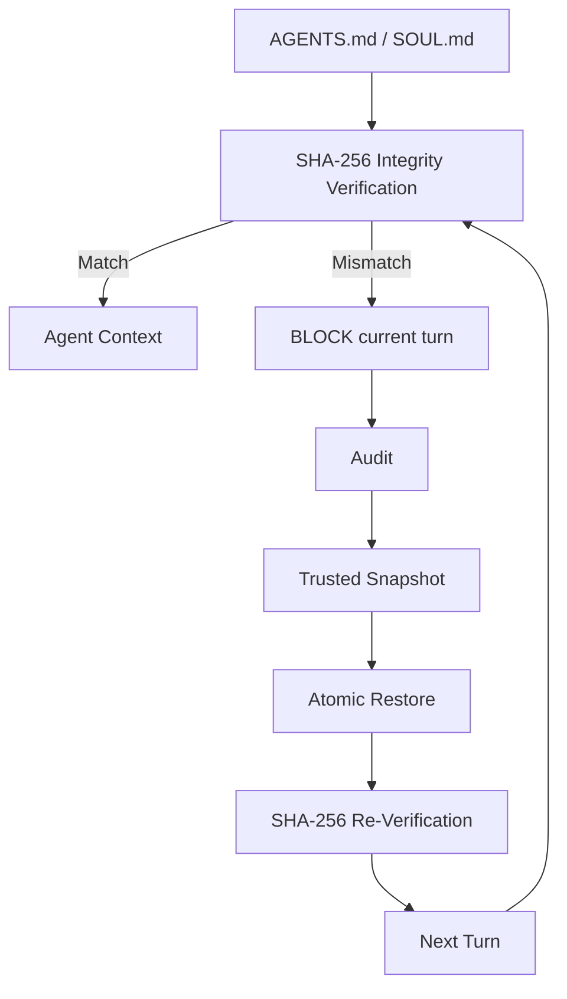
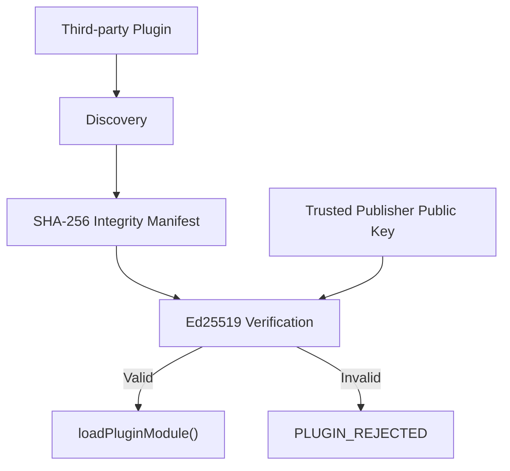

# OpenClaw Security Enhancement

Source-level security enhancements and experimental validation for the OpenClaw local AI Agent framework.

## Research Overview

This project investigates security risks in local AI Agents, including prompt injection, misoperation, persistent policy poisoning, and third-party plugin tampering.

Based on the experimental findings, three source-level security mechanisms were implemented and evaluated in OpenClaw.

## Security Enhancements

### 1. Policy Integrity Guard

The guard protects `AGENTS.md` and `SOUL.md` with a SHA-256 trusted baseline. Verification occurs before policy content enters the Agent Context. A mismatch fails closed with `POLICY_INTEGRITY_BLOCKED`.

### 2. Audit & Trusted Rollback

On an integrity mismatch, the system blocks the current read, records an audit event, obtains the trusted snapshot, performs an atomic restore, and re-verifies the restored bytes with SHA-256. The current turn remains blocked after recovery; only a later turn may load the restored trusted policy.

### 3. Plugin Trust Verification

Plugin verification combines a SHA-256 integrity manifest, an Ed25519 digital signature, a trusted publisher public key, and security auditing. Verification occurs before `loadPluginModule()`. A tampered or untrusted plugin is rejected with `PLUGIN_REJECTED` before module execution.

## Experimental Results

| Security Mechanism | Baseline | Hardened |
|---|---:|---:|
| Policy Poisoning | 6/6 loaded | 6/6 blocked |
| Trusted Rollback | No automatic recovery | 6/6 recovered |
| Next-turn Policy Recovery | - | 6/6 |
| Tampered Plugin Execution | 6/6 executed | 0/6 executed |
| Tampered Plugin Rejection | - | 6/6 |
| Pre-Execution Protection | - | 100% |

Residual Plugin Execution Rate: **0%**

These percentages describe the controlled scenarios in this repository, not real-world LLM attack success rates or a general security guarantee.

## Architecture

### Policy integrity and rollback

### Plugin verification

## Experimental Methodology

- Controlled, isolated environments with temporary experiment directories.
- Equivalent security conditions within each baseline/hardened comparison.
- No real secrets, production plugins, or real workspaces were modified.
- Policy Integrity and Trusted Rollback used controlled deterministic experiments.
- Plugin Verification used real discovery, a filtered harmless fixture candidate, and the real `loadOpenClawPlugins()` path.

Detailed results and retained CSV records are in [`experiments/`](experiments/).

## Research Scope and Limitations

- Reported percentages apply only to the tested scenarios and are not a guarantee of complete security.
- The trusted state database is not protected by a TPM or an independent security principal.
- The same OS user, when granted sufficient access, may tamper with the state database.
- A plugin's complete `node_modules` dependency tree is not fully signed.
- Verify-then-import time-of-check/time-of-use risks may remain.
- The current research focuses on OpenClaw.

## Research Debugging Notes

The work retained failed and intermediate experiments rather than rewriting the record:

1. A rollback feature-flag bug was discovered and fixed.
2. The initial plugin experiment harness scanned shared plugin roots.
3. The first plugin fixture lacked `configSchema`.
4. The marker environment variable was initially passed incorrectly.

See the research notes under [`docs/`](docs/) for the full diagnoses.

## Repository Layout

- `src/policy-integrity/`: Policy Integrity implementation and tests.
- `src/trusted-rollback/`: implementation-location note for Trusted Rollback.
- `src/plugin-verification/`: Plugin Verification implementation and tests.
- `docs/`: design, integration, bug-fix, and experiment-harness notes.
- `experiments/`: final controlled results and available CSV records.
- `figures/`: reserved for publication figures.

## Based on OpenClaw

This repository contains research modifications based on the OpenClaw open-source project.

It is not an official OpenClaw release.

Original OpenClaw code is licensed under the MIT License. Research modifications in this repository are provided for academic and experimental purposes. The original OpenClaw MIT attribution is retained in [`LICENSE`](LICENSE).
